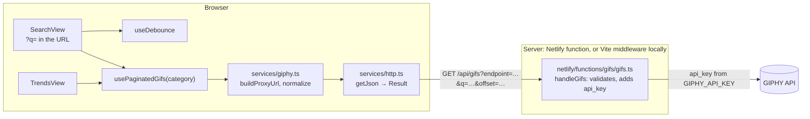

# vue-gifs

A GIF browser for trending GIFs and search, built on the [GIPHY API](https://developers.giphy.com/docs/api/).

**Demo:** https://shimmering-blancmange-2b1e5e.netlify.app/

| Trending                                                                                                                | Search                                                                                                                |
| ----------------------------------------------------------------------------------------------------------------------- | --------------------------------------------------------------------------------------------------------------------- |
|  |  |

- **Trending** and **Search** pages with infinite scroll
- Search is debounced, kept in the URL (`/search?q=cats`, so it can be shared and reloaded), runs at once on Enter and is cleared with Escape. Results are ranked for Czech (`DEFAULT_LANG = 'cs'` in `src/config/api.ts`)
- Superseded requests are cancelled, and late responses are ignored
- The GIPHY API key never reaches the browser
- Accessible: skip link, visible focus ring, list semantics, a live region for loading and empty states, and lazy-loaded `` with alt text

**Stack:** Vue 3 (`<script setup>`), TypeScript, Vue Router, Tailwind CSS 4, Vite, Vitest, Playwright, and a Netlify function as the API proxy.

## Architecture



In production, `/api/gifs` is a Netlify function. Locally, `npm run dev` and `npm run preview` serve the same handler as Vite middleware (the `giphyProxy` plugin in `vite.config.ts`), so the Netlify CLI isn't needed.

| Path                                  | Role                                                                                                                                                                                           |
| ------------------------------------- | ---------------------------------------------------------------------------------------------------------------------------------------------------------------------------------------------- |
| `src/views/`                          | Pages. They own the URL (`?q=`), focus handling and which message shows.                                                                                                                       |
| `src/composables/usePaginatedGifs.ts` | Per-page state: `gifs`, `isLoading`, `isLoadingMore`, `hasMore`, `error`, `isEmpty`, `query`, plus `load`, `loadMore`, `retry`, `cancel`, `reset`. Cancels its request when the page unmounts. |
| `src/composables/useDebounce.ts`      | `run`/`cancel` debounce, cleared when the page unmounts.                                                                                                                                       |
| `src/services/http.ts`                | `getJson` never throws. It returns `{ ok: true, data }` or `{ ok: false, error }`, where the error kind is `aborted`, `network`, `http` or `parse`.                                            |
| `src/services/giphy.ts`               | Builds proxy URLs and normalizes GIPHY responses to `{ results, next }`.                                                                                                                       |
| `src/components/`                     | `GifList` (one infinite-scroll sentinel), `GifItem`, `GifStatus` (live region), `LoadError` (**Try again**).                                                                                   |
| `netlify/functions/gifs/gifs.ts`      | The proxy: `GET` only. It reads only `endpoint` (`trending` or `search`), `q` and a numeric `offset`, and sets the key, limit, rating and (for search) language itself.                        |
| `src/config/api.ts`                   | Constants shared by the client and the function.                                                                                                                                               |

## Decisions and trade-offs

- **A typed `Result` instead of `null` or exceptions.** The HTTP layer used to return `null` on any failure, which hid the cause. Now every failure is a typed value, and a cancelled request (`aborted`) is not treated as an error.
- **Cancellation.** Each page has one `AbortController`. A new search, a load from the start or leaving the page aborts the in-flight request. A `requestId` check also drops responses that arrive out of order. The proxy hands the request's abort signal on to its GIPHY call. This is verified in local dev and preview; on Netlify it depends on the platform firing `req.signal`.
- **Per-page composables instead of a shared Pinia store.** Trending and Search used to share one store, so state leaked between them. Each `usePaginatedGifs(category)` call now owns its state. Pinia is reserved for state that really is shared across pages, and there is none yet.
- **A serverless proxy for the API key.** The key used to be a `VITE_` variable, inlined into every build. It is now a server-only `GIPHY_API_KEY`. The trade-off is one extra hop per request.
- **The URL is the source of truth for search.** Typing debounces into `router.replace({ query: { q } })`, and a watcher on `?q=` does the fetch. Deep links, reloads and history navigation all go through the same code path, and searches don't add history entries.
- **One infinite-scroll sentinel.** A single `IntersectionObserver` target after the list, rather than one per item. It pauses while a load-more error is showing, so a failing request isn't retried in a loop.
- **Tests never call GIPHY.** The unit tests stub `fetch` or the service. The e2e tests mock `/api/gifs` with `page.route` and run with an empty key, so a request a test forgets to mock fails instead of spending quota.

### Known limitations

These are tracked under **Found issues** in [`docs/PLAN.md`](docs/PLAN.md):

- `/api/gifs` is an open proxy with no rate limit or `Cache-Control`.
- Responses are not validated at runtime, so a malformed `200` becomes a generic error.
- GIFs autoplay and ignore `prefers-reduced-motion`.
- Offset pagination can return the same GIF on two consecutive pages.
- Every failure shows the same "Failed to load GIFs." message.
- An abort the app didn't cause leaves a blank page with no **Try again**.
- Route changes don't move focus or announce the new page to screen readers.
- Pinia is still registered, although no store uses it.
- `npm audit` reports vulnerable transitive dependencies (one critical, in `tar`), which need a dependency-upgrade pass.
- Netlify deploys don't wait for CI, so a PR preview can go live while checks are failing.

## How AI tools were used

The project was refactored from a 2022 hobby app with **Claude Code** and **OpenAI Codex**, both driven by the same instructions and the same workflow.

- **One source of instructions.** [`AGENTS.md`](AGENTS.md) holds the stack, commands, conventions and working rules. Codex reads it directly, and `CLAUDE.md` imports it with `@AGENTS.md`.
- **A plan as the backlog.** [`docs/PLAN.md`](docs/PLAN.md) lists numbered steps with `Needs:` dependencies. An agent picks up one step at a time and logs anything out of scope under **Found issues** rather than fixing it on the side.
- **Shared tooling** for both tools:
  - Skills in `.agents/skills/`: `next-step` (plan, then wait for approval, then implement) and `verify`.
  - Agents: a `reviewer` and a `test-writer`, defined for both tools. In Claude Code the reviewer has no edit tools. Codex subagents inherit the parent sandbox, so a strictly read-only review there needs `codex --sandbox read-only`.
  - Hooks: lint and format on every edit (`scripts/ai/lint-on-edit.sh`) and a typecheck at the end of each turn (`scripts/ai/typecheck-on-stop.sh`).
  - The Playwright MCP, so agents can check the UI in a real browser.
- **Test-first with a writer/tester split.** For logic changes, the `test-writer` agent writes failing specs from the plan step, and I approve them. The implementing agent then makes them pass without editing any `*.spec.ts` file. Assertions are never loosened to make a test pass.
- **Layered review.** `npm run verify`, then the `reviewer` subagent against the plan, then the tool's built-in code review, then a cross-model review (Claude reviews Codex's diff and vice versa).
- **Guardrails.**
  - **Commits.** A human reviews and commits every change. `AGENTS.md` tells agents never to commit or push. In both tools a commit needs approval, and Claude Code also denies `git push`.
  - **Claude Code** (`.claude/settings.json`): Bash runs in a sandbox. `.env*` files can't be read, the network is limited to the npm registry, and package installs and `npx` ask first. The Playwright MCP is the exception: it runs outside that network allowlist.
  - **Codex** (`.codex/config.toml`): uses `workspace-write` with `approval_policy = "on-request"`. Writes stay inside the repo, `.git` is read-only, and network access needs approval. Keeping it out of `.env*` files relies on the `AGENTS.md` rule.

## Development

Requires Node `>=22.12` (`.nvmrc` pins the version) and a free [GIPHY API key](https://developers.giphy.com/dashboard/).

```sh
npm install
cp .env.example .env.local   # then set GIPHY_API_KEY
npm run dev                  # http://localhost:5173
```

| Command                             | What it does                                                                          |
| ----------------------------------- | ------------------------------------------------------------------------------------- |
| `npm run dev`                       | Dev server with HMR and the `/api/gifs` proxy                                         |
| `npm run build` / `npm run preview` | Production build, served on port 4173                                                 |
| `npm test`                          | Vitest unit and component tests (jsdom)                                               |
| `npm run test:e2e`                  | Playwright tests against a preview build on port 4174, with `/api/gifs` mocked        |
| `npm run verify`                    | Typecheck, lint, format check, unit tests and build. Husky `pre-push` and CI run it   |
| `docker compose up --build -V dev`  | Dev server in Docker on port 5173                                                     |
| `docker compose up --build preview` | Production build in Docker on port 4173 (reads `.env.local`, so that file must exist) |

Before running `npm run test:e2e` for the first time, install the browser with `npx playwright install chromium-headless-shell`.

Git hooks: `pre-commit` runs lint-staged, `commit-msg` checks [Conventional Commits](https://www.conventionalcommits.org/), and `pre-push` runs `npm run verify`.

### CI and deploy

- **CI.** GitHub Actions (`.github/workflows/ci.yml`) runs `npm run verify` and, in a separate job, the e2e suite, on every push to `main` and on every PR.
- **Deploy.** Netlify builds from GitHub (`netlify.toml`). `main` deploys to production, and each pull request gets a deploy preview.
- **Netlify setup.** Set `GIPHY_API_KEY` as a secret environment variable with the Functions scope, for the Production and Deploy Preview contexts. PRs from forks don't get secrets, so their previews can't load GIFs.
